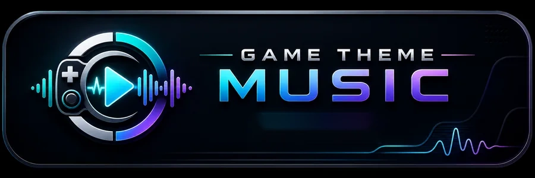
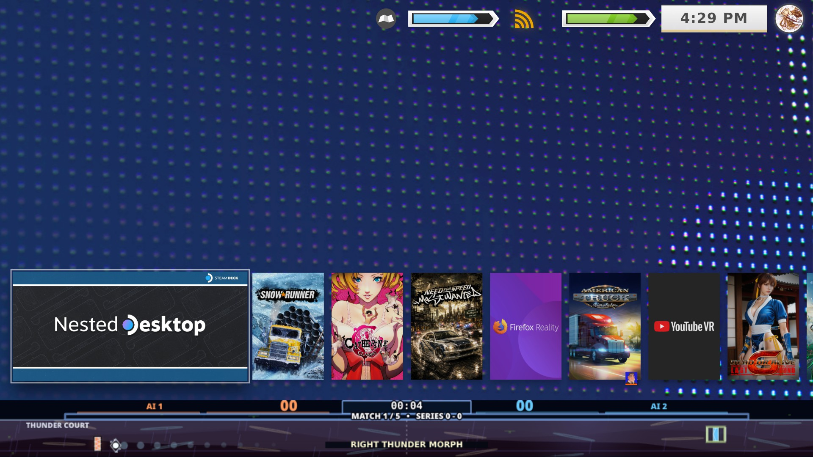
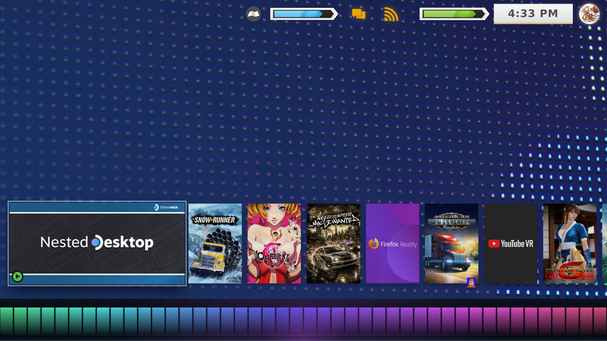
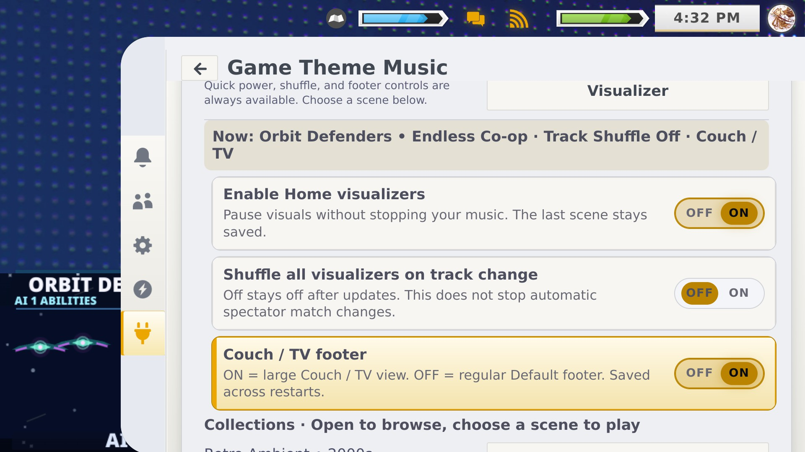

# 🎵 Game Theme Music
### Faites sonner votre Steam Deck aussi bien qu'il en a l'air.

**4.6.7 · Stable · Maintenance active · Steam Deck / Decky Loader**  
**Développé par Valentine**

[**⬇ Télécharger la 4.6.7**](https://github.com/ValentineBSAA/Game-Theme-Music/releases/tag/V4.6.7) · [Notes de version](docs/RELEASE_NOTES_4.6.7.md) · [Premiers pas](docs/GETTING_STARTED.fr.md) · [Captures d'écran réelles](docs/SCREENSHOTS.fr.md) · [Signaler un problème](https://github.com/ValentineBSAA/Game-Theme-Music/issues/new/choose)

**💬 [Dites-nous comment vous utilisez GTM](https://github.com/ValentineBSAA/Game-Theme-Music/issues/2)**

**🇬🇧 [Read this page in English](README.md)**

> **Version publiée actuelle :** [Game Theme Music 4.6.7](https://github.com/ValentineBSAA/Game-Theme-Music/releases/tag/V4.6.7), 6 novembre 2026. Installez le fichier nommé **[Game-Theme-Music-4.6.7.zip](https://github.com/ValentineBSAA/Game-Theme-Music/releases/download/V4.6.7/Game-Theme-Music-4.6.7.zip)** depuis les **Assets** de la version, et **non** le ZIP de code source généré automatiquement par GitHub.

> ℹ️ **À propos de cette traduction :** l'interface du plugin elle-même est en anglais. Les libellés d'interface (menus, boutons, options) sont donc conservés tels quels dans cette page, afin que vous les retrouviez facilement à l'écran.

**Game Theme Music (GTM)** ajoute des bandes originales personnalisables, de la musique d'ambiance pour l'accueil Steam, de la musique native pour le Store Steam et le Decky Plugin Store, ainsi que des mondes visuels réactifs à la musique dans le mode Gaming du Steam Deck. Ses scènes optionnelles **Arcade Spectator** sont un divertissement IA contre IA : ce n'est **pas** un mode multijoueur jouable par des humains.

## ✨ Nouveautés de la 4.6.7

| Amélioration | Ce qui change |
| --- | --- |
| **Interrupteurs du menu contextuel de la bibliothèque (corrige [#10](https://github.com/ValentineBSAA/Game-Theme-Music/issues/10))** | Affichez ou masquez indépendamment **Change Music**, **Change Ambient Playlist** et **Change Store Playlist**. Masquez des raccourcis sans désactiver la musique ni supprimer vos playlists. |
| **Navigation du Quick Menu** | Menu déroulant **Browse all pages · A–Z** en complément du changement de page LB/RB ; moins de défilement automatique et de sauts de focus concurrents. |
| **Store Steam natif** | Meilleure reconnaissance de l'entrée et de la sortie du Store, y compris lorsque les informations de navigation de Steam sont obsolètes ; moins de musique du Store qui persiste au retour à l'accueil ou à la bibliothèque. |
| **Decky Plugin Store** | Détection de visibilité et démarrage de la musique du Store plus fiables, sans redémarrer Steam. |
| **Coordination de la lecture** | GTM s'efface devant l'audio ResonaDeck déjà en cours. La musique du Store reprend quand c'est opportun, sans écraser une pause volontaire. |
| **Contrôle des visualiseurs** | Associé à **ResonaDeck 1.5.7**, les préférences de démarrage enregistrées n'imposent plus les visualiseurs en position ON. Des visualiseurs activés peuvent apparaître avec une musique éligible, et non sur un accueil inactif. |
| **Charge de fond réduite** | Moins d'écritures redondantes de l'état des playlists, surveillance des thèmes resserrée et nettoyage amélioré des hooks et des écouteurs d'événements. |
| **Téléchargeur conservé** | **YT-DLP et QuickJS restent inclus** dans le ZIP installable ; le téléchargement n'a pas été retiré. |

Le mainteneur a testé le parcours Store final de la **4.6.7** sur un Steam Deck physique **sans redémarrage après l'installation**, y compris les deux surfaces du Store, le retour à l'accueil et l'interaction avec ResonaDeck. Les tests 4.6.x antérieurs couvraient chaque interrupteur du menu contextuel, la navigation et la visibilité des visualiseurs. La sortie réactive aux fréquences de ResonaDeck a été observée fonctionnelle après avoir basculé son contrôle de partage en OFF puis ON ; un comportement universel et automatique à la première connexion n'est **pas** affirmé. Détails : [notes de version](docs/RELEASE_NOTES_4.6.7.md) et [compte rendu de test matériel](TESTING.md).

## 📦 Installer ou mettre à jour

1. Ouvrez la [version 4.6.7](https://github.com/ValentineBSAA/Game-Theme-Music/releases/tag/V4.6.7) et téléchargez **[Game-Theme-Music-4.6.7.zip](https://github.com/ValentineBSAA/Game-Theme-Music/releases/download/V4.6.7/Game-Theme-Music-4.6.7.zip)** sous **Assets**.
2. Dans Decky Loader, utilisez son option manuelle **Install Plugin from ZIP**. Conservez vos préférences enregistrées lors de la mise à jour.
3. Ouvrez **Quick Access → GTM**. Le message de bienvenue propre à chaque version peut apparaître sur l'accueil Steam lorsque Quick Access est fermé ; appuyez sur **A / Cross** pour continuer.
4. Un redémarrage complet du Steam Deck n'est normalement pas nécessaire. Si Steam conserve d'anciens hooks de menu ou un état d'interface obsolète après une mise à jour à chaud, fermez puis rouvrez Quick Access, et redémarrez Steam si nécessaire.

[Vérifier le SHA-256 du ZIP](docs/RELEASE_ASSET_SHA256_4.6.7.txt) · [Guide d'installation complet](docs/GETTING_STARTED.fr.md) · [Index des versions et des retours arrière](docs/RELEASE_INDEX.md)

## 🎮 Fonctionnalités principales

| Fonctionnalité | Expérience |
| --- | --- |
| Musique de jeu | Bandes originales pour les jeux Steam et non-Steam, playlists et options de fondu enchaîné. |
| Ambient / Accueil | Musique de fond pendant la navigation sur l'accueil Steam, avec des options distinctes d'activation et de veille/réveil. |
| Musique du Store | Musique pour le **Store Steam et le Decky Plugin Store**, avec une meilleure détection des surfaces et une meilleure priorité audio. |
| Mondes visuels | Scènes rétro, rythmiques, signature, anime et spectateur IA, packs de visualiseurs personnalisés et couleurs adaptées à CSS Loader. |
| Arcade Spectator | Scènes IA contre IA **en mode spectateur uniquement**, dont Pong. Ce n'est pas un mode multijoueur local ni un jeu d'arcade contrôlé par le joueur. |
| Navigation à la manette | Sélecteur de page direct A–Z, pagination LB/RB et raccourcis musicaux personnalisables. |
| Intégration ResonaDeck | Interrupteur de visualiseur partagé et télémétrie réactive à la musique lorsque vous êtes connecté à une version compatible de [ResonaDeck 1.5.7](https://github.com/ValentineBSAA/ResonaDeck/releases/tag/1.5.7). |

### 🎛️ Personnalisation du menu contextuel

Dans les réglages de GTM, contrôlez individuellement la visibilité de **Change Music**, **Change Ambient Playlist** et **Change Store Playlist**. Désactiver une entrée de menu ne fait que masquer ce raccourci. Cela **ne** coupe **pas** la fonction musique, **n'efface pas** votre playlist et **ne modifie pas** les options de menu contextuel d'un autre plugin (y compris TitleDeck).

### 🌈 Les visualiseurs sont facultatifs

Ouvrez **Quick Access → GTM → Visualizers → Enable Home visualizers**. **OFF** masque le visualiseur sans arrêter l'audio ; **ON** l'autorise pendant une lecture éligible, et non lorsque l'accueil est inactif. **Shuffle All Visualizers on Track Change** est un réglage distinct.

Si une scène propulsée par ResonaDeck apparaît mais ne réagit pas au rythme, essayez de basculer l'interrupteur de partage **GTM Visualizers** en OFF puis ON dans ResonaDeck pour rafraîchir la capture audio. Voir [l'assistance ResonaDeck](https://github.com/ValentineBSAA/ResonaDeck/blob/main/SUPPORT.md).

## 📸 Captures réelles d'un Steam Deck (4.4.9, historique)

Ce sont **15 captures authentiques d'une version antérieure**, et non une affirmation qu'elles montrent tous les réglages ou effets de la 4.6.7.

| Spectateur IA | Visualiseur classique | Anciens contrôles de visualiseur |
| :---: | :---: | :---: |
|  |  |  |

[Voir les 15 captures d'écran](docs/SCREENSHOTS.fr.md)

## 🎧 Dites-nous comment vous utilisez GTM

**J'aimerais beaucoup savoir ce que GTM donne réellement sur votre Steam Deck.** ❤️

Les téléchargements me disent que GTM atteint des gens, mais pas quelles parties vous plaisent, ce que vous utilisez vraiment ni ce qui pourrait être amélioré. Que vous utilisiez GTM depuis des mois ou que vous veniez de l'installer, vous êtes les bienvenus.

> **💬 [Rejoignez la conversation de la communauté GTM →](https://github.com/ValentineBSAA/Game-Theme-Music/issues/2)**  
> Aucun rapport de bug n'est nécessaire. Partagez votre expérience, une fonctionnalité préférée, une capture d'écran, une petite frustration, ou simplement un bonjour.

Quelques questions qui m'intéressent :

- 🎵 Utilisez-vous surtout les bandes originales de jeux, la musique d'accueil/Ambient, la musique du Store, les visualiseurs ou ResonaDeck ?
- ✨ Qu'est-ce qui fonctionne particulièrement bien pour vous ?
- 🛠️ Qu'est-ce qui est confus, peu fiable, ou que vous changeriez ?

**Les retours honnêtes sont les bienvenus, y compris les critiques.** Une phrase suffit. Je me concentre sur la stabilité, l'usage quotidien et les améliorations centrées sur la musique, je ne peux donc pas promettre que chaque suggestion deviendra une fonctionnalité.

Si vous avez trouvé quelque chose de cassé et pouvez le reproduire, merci d'[ouvrir un rapport de bug](https://github.com/ValentineBSAA/Game-Theme-Music/issues/new/choose) afin que je puisse le suivre séparément.

*Merci de m'avoir écouté et de m'aider à améliorer GTM.*  
**Valentine** 🎵

---

## ❤️ Maintenance et communauté

GTM est **activement maintenu**, pas abandonné. Les priorités actuelles sont les corrections de bugs reproductibles, la compatibilité SteamOS/Decky, la fiabilité audio, l'ergonomie à la manette et une finition ciblée. Aucun calendrier de fonctionnalités n'est promis. [Politique de maintenance](docs/MAINTENANCE.fr.md) · [Contribuer](CONTRIBUTING.md).

- [Signaler un bug reproductible](https://github.com/ValentineBSAA/Game-Theme-Music/issues/new/choose). Indiquez la version de GTM, les versions de SteamOS/Decky, la surface du Store concernée et les étapes de reproduction.
- [Partager votre expérience GTM](https://github.com/ValentineBSAA/Game-Theme-Music/issues/2), un fil ouvert pour les retours et la conversation du quotidien.
- [Limites de compatibilité](docs/STEAMOS_COMPATIBILITY.md), [compte rendu de test](TESTING.md), [journal des modifications](CHANGELOG.md).
- [Archives de développement](docs/archive/README.md) : expérimentations historiques et versions antérieures. Les notes historiques ne sont pas des instructions d'installation actuelles.

## Source et packaging

**Le ZIP d'installation publié en 4.6.7 est l'artefact installable de référence.** L'instantané du code frontend/backend suivi dans le dépôt peut être en retard sur ce ZIP ; ne considérez pas l'archive source automatique de GitHub comme un plugin autonome, et ne partez pas du principe que la copie locale est identique octet pour octet au runtime 4.6.7. Voir [SOURCE.md](SOURCE.md) pour une provenance exacte et les [notices de tiers](THIRD-PARTY-NOTICES.md).

**Mainteneur :** Valentine ([ValentineBSAA](https://github.com/ValentineBSAA)) · **Licence :** GPL-3.0-only ([LICENSE](LICENSE))

Merci d'écouter, de tester et d'aider GTM à s'améliorer. ❤️
