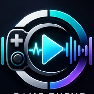

  

<h1 align="center">Game Theme Music</h1>

  Give Steam and non-Steam games their own soundtrack on Steam Deck.

  <strong>Latest stable release: 3.7.0</strong>

## Download

**[Download Game Theme Music 3.7.0](https://github.com/ValentineBSAA/Game-Theme-Music/releases/download/V3.7.0/Game-Theme-Music-3.7.0.zip)**

[View release notes](https://github.com/ValentineBSAA/Game-Theme-Music/releases/tag/V3.7.0) · [Report a problem](https://github.com/ValentineBSAA/Game-Theme-Music/issues)

Game Theme Music is currently distributed as a manual Decky Loader plugin while wider community testing continues.

## Browse the source

The 3.7.0 release's **editable [Python backend](main.py)** and **[compiled JavaScript frontend](dist/index.js)** are now browsable here, alongside artwork and license information. See [Source code and limitations](SOURCE.md) for checksum verification and the important distinction between the compiled frontend and the unavailable original React/TypeScript source.

## Install

1. Open **Decky Loader** on your Steam Deck.
2. Enable the Developer/manual plugin installation option in Decky settings.
3. Download **Game-Theme-Music-3.7.0.zip** from the link above.
4. Install the ZIP through Decky’s manual plugin installer.
5. Reload Decky if prompted.

That is the whole install. You do not need to clone this repository or build anything yourself.

## What Game Theme Music does

- Give individual Steam and non-Steam games their own music playlists.
- Add separate **Ambient** and **Steam Store** music.
- Import music you already own.
- Find and preview music from supported sources.
- Shuffle, repeat, change tracks, adjust volume, fades, and timing.
- Keep artwork available locally for a cleaner offline experience.
- Manage everything from a full-screen, controller-first **Soundtrack Manager**.
- Work with Steam Deck Gaming Mode instead of feeling like a desktop settings app.

Game Theme Music supports up to **15 tracks per game**.

## What's new in 3.7.0: optional mini-player HUD

**Settings → Interface & Feedback → Show mini player HUD** (ON by default).

Turn the switch OFF to hide the SAO-style Now Playing overlay while game, Store and Ambient music continues playing normally. The setting survives a full Steam Deck restart. Turn it back ON to restore future Now Playing popups.

The feature was **hardware-tested on Steam Deck** with Catherine Classic, NFS Most Wanted 2005, native Steam Store, Decky Plugin Store and Ambient Home music. The OFF setting persisted through a reboot and re-enabling restored the HUD.

**Thanks to Dollet** for bringing the missing on/off option to our attention through Discord.

[Full 3.7.0 release notes](docs/RELEASE_NOTES_3.7.0.md) · [Steam Deck validation](docs/VALIDATION_3.7.0.md) · [Release checksum manifest](docs/RELEASE_MANIFEST_3.7.0.md)

## Previous release: 3.6.9 ResonaDeck audio focus

Version 3.6.9 kept the existing 3.6.8 playback, artwork, Store, Ambient, and library behavior and added cooperative **ResonaDeck audio focus**.

When ResonaDeck takes audio focus, GTM can pause its current soundtrack. When focus is released, GTM resumes only when the same soundtrack is still the valid paused owner.

The new 3.7.0 HUD control has been tested on a real Steam Deck with Steam/non-Steam games, both Stores, Ambient Home music, a full restart, and re-enabling. More independent hardware testing remains welcome.

### Especially useful tests

- Steam and non-Steam games
- Steam Store playback
- Ambient playback
- artwork and notifications
- controller navigation
- local imports
- coexistence with ThemeDeck or other audio plugins
- ResonaDeck audio-focus pause/resume

If something breaks, use the **Report a problem** link above. The issue form will ask for the useful details.

## Screenshots

Real Steam Deck screenshots can be added here later. The download and project are already usable without them.

## Download safety

Use the release files from this repository rather than similarly named mirrors.

**3.7.0 ZIP SHA-256:** `78d8b305634ff4b188dfb4ab596b327ec717533dbe84bb9ce19338c5eb53cd15`. See [the versioned release manifest](docs/RELEASE_MANIFEST_3.7.0.md) for complete integrity details. The previous 3.6.9 ZIP SHA-256 was `84364fe71ef5a65b9fae513ba0e8449cf670017f9d51b2da2807df9186d6a1df`.

<strong>Decky Plugin Explorer</strong>

This repository includes a root-level `plugin.json` so community discovery tools can recognize it as a Decky plugin.

Decky Plugin Explorer:
https://safetzahirovic.github.io/decky-plugins-explorer/

<strong>Development, licensing, and project lineage</strong>

Game Theme Music uses AI-assisted development under Valentine’s direction with iterative Steam Deck hardware testing.

Current developer: **Valentine**

Project lineage:
- OMGDuke / SDH-GameThemeMusic
- MegalonVII / SDH-GameThemeMusic
- Valentine / Game Theme Music

Game Theme Music continues the GPL-licensed project lineage and is distributed under **GPL-3.0-only**. See [LICENSE](LICENSE).

Bundled/runtime third-party software has its own licensing requirements. In particular, yt-dlp itself uses the Unlicense, while upstream standalone executables can contain third-party components under additional licenses. The bundled yt-dlp executable is therefore documented using the complete upstream third-party licensing information rather than being described simply as “Unlicense.”

See [THIRD-PARTY-NOTICES.md](THIRD-PARTY-NOTICES.md) for details.

Technical validation:
- [3.7.0 hardware validation](docs/VALIDATION_3.7.0.md)
- [3.7.0 release manifest](docs/RELEASE_MANIFEST_3.7.0.md)
- [3.6.9 validation notes](docs/VALIDATION_3.6.9.md)
- [3.6.9 release manifest](docs/RELEASE_MANIFEST_3.6.9.md)
- [ResonaDeck audio-focus notes](docs/RESONADECK_AUDIO_FOCUS_3.6.9.md)

