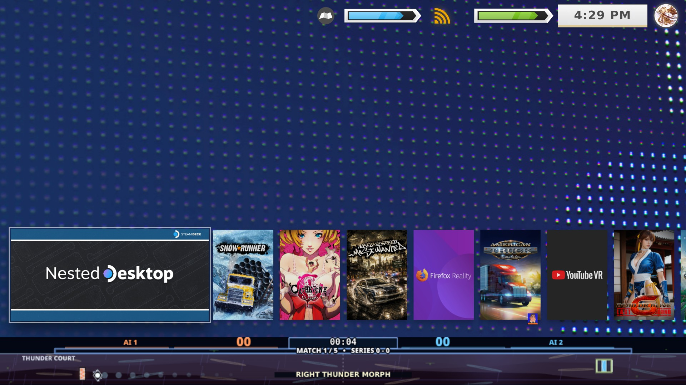
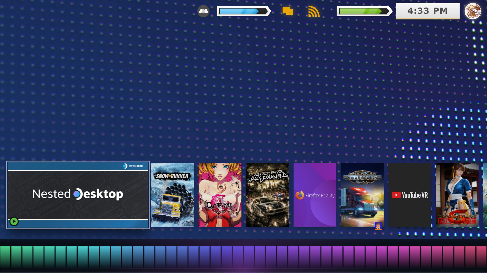
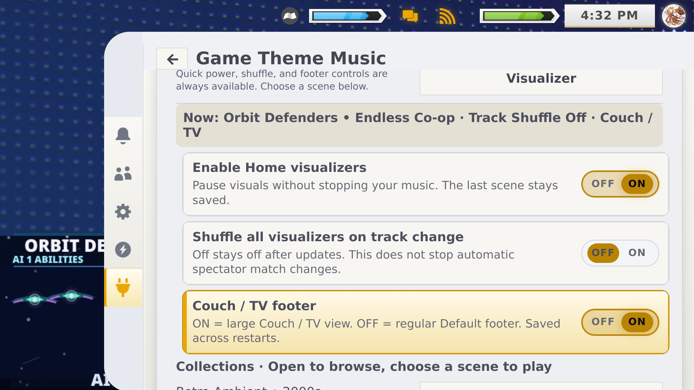

# 🎵 Game Theme Music
### Make your Steam Deck sound as good as it looks.

**Developed by Valentine · Current release: 4.5.8 · Active maintenance · Steam Deck / Decky Loader**

[**Download 4.5.8**](https://github.com/ValentineBSAA/Game-Theme-Music/releases/tag/V4.5.8) · [View 15 real screenshots](docs/SCREENSHOTS.md) · [Getting started](docs/GETTING_STARTED.md) · [Current release notes](docs/RELEASE_NOTES_4.5.8.md) · [Get help](https://github.com/ValentineBSAA/Game-Theme-Music/issues/new/choose)

**Game Theme Music (GTM)** is a music-first Decky Loader plugin for Steam Deck. Play soundtracks for Steam and non-Steam games, add music to Home and Store browsing, and customize music-reactive visual worlds. GTM also offers optional **AI-versus-AI spectator visualizers** that animate automatically alongside music. **Arcade Spectator remains a watch-only, AI-versus-AI feature in 4.5.8; it does not advertise human-playable multiplayer.**

> **Current direction:** GTM 4.5.8 is **feature-complete for now and actively maintained**. I'm focusing on reliability, bug fixes, SteamOS/Decky compatibility, playback, settings and polish rather than adding more major features. **GTM is not abandoned or end-of-life.** [Read the maintenance policy](docs/MAINTENANCE.md).
>
> **Version 4.5.8** is the current regular public release. Its paired visualizer controls with ResonaDeck were tested on physical Steam Deck hardware. Broader compatibility across SteamOS builds, themes, and visualizer configurations is not guaranteed.

## Get GTM

1. Open the [**4.5.8 release page**](https://github.com/ValentineBSAA/Game-Theme-Music/releases/tag/V4.5.8).
2. Under **Assets**, download **`Game-Theme-Music-4.5.8.zip`**. Use the **attached plugin ZIP**, **not** GitHub's auto-generated `Source code` archive.
3. Install the plugin ZIP through Decky Loader's manual installation option on Steam Deck. Keep a backup before changing versions. Existing preferences are intended to remain intact during normal updates.
4. Open GTM in Quick Access. The one-time welcome displays on **Steam Home** when Quick Access is closed; press **A / Cross** to continue.

Verify the installable ZIP against [the recorded SHA-256 checksum](docs/RELEASE_ASSET_SHA256_4.5.8.txt). Full instructions: **[Getting started](docs/GETTING_STARTED.md)**.

## 🎛️ Visualizers are optional

**Want music without animated visualizers? You can turn visualizers OFF.** Open **Quick Access → GTM → Visualizers → Enable Home visualizers** and switch it **OFF**. Game soundtracks, Home Ambient music and Store music continue working; the visualizer footer is simply hidden. Switch **ON** whenever you want the visuals back. **Shuffle All** is a separate setting for automatic scene changes, not the visualizer ON/OFF control.

## What GTM offers

| Feature | Experience |
| --- | --- |
| 🎮 **Game Music** | Soundtracks for Steam and non-Steam titles, playlist management and optional crossfade. |
| 🌙 **Ambient / Home** | Background music while browsing Steam Home, with configurable sleep/wake behavior. |
| 🛍️ **Store Music** | Configure music for Steam and Decky Store browsing. |
| 🌈 **Visual Worlds** | **Expanded visualizer collection**, including original retro, rhythm, signature, anime and spectator-style scenes; optional custom packs. |
| 🏓 **Arcade Spectator** | **Watch-only AI-versus-AI scenes**, adaptive Pong opponents, auto-changing paddles, arenas, ball physics and **32 powers/effects**. No gameplay controls or multiplayer matchmaking. |
| 🎨 **Customize** | Controller-friendly Visualizers and Arcade Spectator tabs, nested scene categories, palette and color settings, music reactivity and Default / Couch-TV footer layout. |
| 🎧 **ResonaDeck** | Compatible music-reactive integration and bidirectional live visualizer ON/OFF with ResonaDeck 1.4.9. |

## 📸 Previous-version Steam Deck screenshots (4.4.9)

**A selection of 15 screenshots, not every visualizer.** The gallery shows AI spectator scenes, traditional music visualizers and the Quick Menu, including the ON/OFF switches. Different visualizer packs, colors and effects are not all pictured.

| Autonomous AI spectator | Traditional music visualizer | Visualizer ON/OFF controls |
| :---: | :---: | :---: |
|  |  |  |

**[Browse all 15 screenshots by category →](docs/SCREENSHOTS.md)** · [Download the original screenshot ZIP from the release](https://github.com/ValentineBSAA/Game-Theme-Music/releases/download/V4.4.9/GTM.4.4.9.screenshots.zip)

### Find the visualizer controls

Open **Decky Quick Access → GTM → Visualizers** to choose a collection and then a scene. Opening a collection only browses it; select a scene to activate it. The **Arcade Spectator** page controls the autonomous spectator visuals. Both areas expose relevant color, reaction and layout controls. **Shuffle All Visualizers on Track Change** is optional and its explicitly saved Off state is designed to survive updates.

For Couch/TV viewing, choose the larger footer layout; choose Default for a compact Home layout. [Step-by-step controls](docs/GETTING_STARTED.md).

### What's new in 4.5.8?

Six new built-in visualizer scenes, a controller-friendly two-column browser, improved eight-second audio crossfade and two-way ResonaDeck visualizer control. The 4.4.9 Pong spectator scoring repair and other existing music features are retained. See the notes for the full details and limitations.

[Full 4.5.8 release notes](docs/RELEASE_NOTES_4.5.8.md) · [Testing and verified hardware observations](TESTING.md) · [Compatibility notes](docs/STEAMOS_COMPATIBILITY.md)

## Active maintenance and community feedback

I'm keeping GTM music-first and maintaining the features already here. Fixes, compatibility work, documentation and meaningful quality-of-life repairs remain welcome; new games and major feature expansions aren't currently planned. **There's no fixed update schedule or promise that every suggestion will be implemented.** For what is in scope, see the [maintenance policy](docs/MAINTENANCE.md) and [contributing guide](CONTRIBUTING.md). The current stable release is **4.5.8**; updates remain selective and focused on stability.

## Need help or have an idea?

- **[Report a bug](https://github.com/ValentineBSAA/Game-Theme-Music/issues/new?template=bug_report.md)**. GTM version, Deck/SteamOS details and reproduction steps are helpful; screenshots and logs are optional.
- **[Request a feature](https://github.com/ValentineBSAA/Game-Theme-Music/issues/new?template=feature_request.yml)** or visit the **[Community Ideas Hub](https://github.com/ValentineBSAA/Game-Theme-Music/issues/2)**.
- **[Read maintenance priorities](docs/MAINTENANCE.md)**. The earlier feature-expansion poll is archived; future fixes are guided by reproducible bugs and compatibility needs rather than a promised feature roadmap.
- **[Browse the visualizer gallery](docs/SCREENSHOTS.md)**. Historical screenshots are labeled; don't mistake concept art for current hardware screenshots.

## ❤️ A little note from me

I started working on Game Theme Music because I liked what it did and saw things I wanted to improve. One fix led to another, then more music features, visualizers, and plenty of Steam Deck testing. I really enjoy working on this stuff, and I'm happy people are giving it a try.

If Game Theme Music has made your Steam Deck a little more fun and you'd like to help support my **ongoing development and maintenance**, you can leave a donation through Cash App. **It's completely optional.** The plugin is free, nothing is locked behind donations, and simply using it, reporting a bug, or sharing feedback means a lot to me.

I also want to give credit to the **original Game Theme Music creator and contributors**. This project started with their work; any donations here support **my maintenance and improvements**, not a claim that I created the original plugin.

  
   
  <strong><a href="https://cash.app/$jilvalentinebsaa">Support my development on Cash App · $jilvalentinebsaa</a></strong>
   
  No pressure, no paid features. Thank you for being here. ❤️

## 🗂️ Development archive

Looking for an older store listing, preview note, test report or experimental regression script? I moved the historical files into a **[browseable development archive](docs/archive/README.md)** so the repository homepage is easier to navigate.

These files are preserved for reference, not current installation instructions. **For the supported plugin, use the [current 4.5.8 release](https://github.com/ValentineBSAA/Game-Theme-Music/releases/tag/V4.5.8)** and the [getting-started guide](docs/GETTING_STARTED.md). Nothing from the working runtime or published installer was removed during this cleanup.

## Project notes

**Maintainer:** Valentine ([ValentineBSAA](https://github.com/ValentineBSAA)). **License:** GPL-3.0-only (see LICENSE). The repository tracks the 4.5.8 runtime snapshot and release tests. Large bundled dependencies are included in the *release installer*, not GitHub's source ZIP. The public **4.5.8 installer is self-contained**; you do not need an earlier GTM release to install it.

[Maintenance policy](docs/MAINTENANCE.md) · [Contributing](CONTRIBUTING.md) · [Source and release integrity](SOURCE.md) · [Version history](CHANGELOG.md) · [Archived development README](docs/DEVELOPMENT_HISTORY.md) · [Release index](docs/RELEASE_INDEX.md)

Thank you for installing, testing, and helping improve GTM. ❤️

**Valentine**
