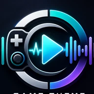
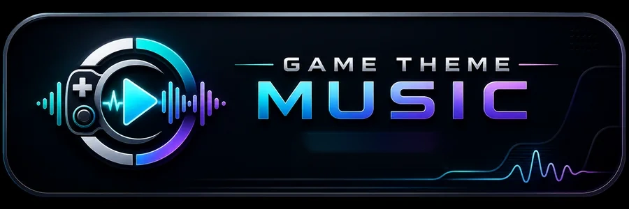
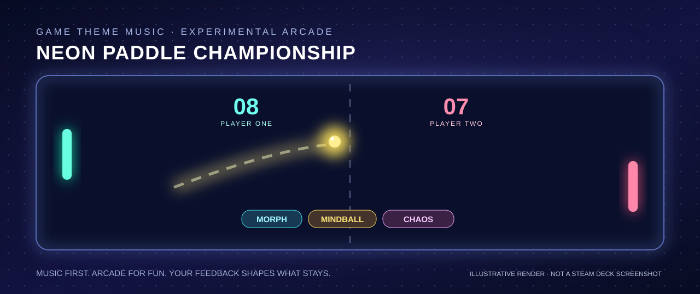

# 🎵 Game Theme Music
### 4.4.1 Public Beta • Music first, Arcade experimental

**Soundtracks for your Steam Deck, music-reactive Visual Worlds, and a playful experiment in interactive Arcade visualizers.**

GTM remains a **music and visualizer plugin** for Decky Loader. The Arcade started as an experiment with making visualizers interactive. It's an optional extra, **not a commitment to make GTM a standalone gaming platform**. We want the community to tell us whether this idea belongs in GTM.

**[🎮 Public beta feedback and game reports](https://github.com/ValentineBSAA/Game-Theme-Music/issues/4)** · [4.4.1 beta notes](docs/RELEASE_NOTES_4.4.1.md) · [Hardware verification matrix](TESTING.md) · [Install instructions](docs/GETTING_STARTED.md)

> **Download status:** The **4.4.1 Public Beta installer is awaiting maintainer upload**. Once published, obtain the named plugin ZIP from **[Releases](https://github.com/ValentineBSAA/Game-Theme-Music/releases)**. The most recent currently published asset on GitHub is [4.1.2](https://github.com/ValentineBSAA/Game-Theme-Music/releases/tag/V4.1.2). **Do not install GitHub's auto-generated “Source code” ZIP.** The main-branch runtime files still reflect the 4.1.2 source snapshot pending an exact-version source synchronization. [Details](SOURCE.md).

## 🎵 GTM's main purpose hasn't changed

- **Game theme music:** Steam and non-Steam game soundtracks, playlists, configurable playback and optional crossfade.
- **Home / Ambient music:** Music for the Steam Deck Home experience, including sleep/wake options.
- **Steam and Decky Store music:** Shared Store soundtrack controls.
- **Visualizer collections:** Built-in **Visual Worlds**, custom packs, vivid reactive colors, animated scenes, and scene shuffle.
- **ResonaDeck integration:** Optional, read-only audio visualization and protected music/audio focus with compatible ResonaDeck versions.
- **Controller-friendly customization:** Quick Menu, Couch / TV sizing, optional mini-player and visualizer preferences.

[Explore music features](docs/GETTING_STARTED.md) · [Visualizer pack guide](docs/VISUALIZER_PACKS_4.0.4.md) · [Screenshots](docs/SCREENSHOTS.md)

## 🎮 Experimental Arcade (4.4.1 Public Beta)

We asked what would happen if a music-reactive Pong visualizer could **actually play Pong**. The answer turned into a small Arcade. These are optional interactive visualizers, not separate installed games.

| Arcade visualizer | Current status, based on maintainer testing |
| --- | --- |
| 🏓 **Neon Paddle Championship** | **Verified on Steam Deck**, including two-controller multiplayer. AI, Chaos, morphs and Mindball are experimental enhancements. |
| 🌌 **Orbital Duel** | **Verified on Steam Deck**, including multiplayer. |
| 🚀 **Orbit Defenders** | **Verified on Steam Deck**, including multiplayer. This is the space-invaders-inspired survival/defense game. |
| 🎯 **Neon Strike Gallery** | **Reported working on Steam Deck**; multiplayer status is still tentative, not a confirmed coverage claim. |
| 🎹 **Beat Catcher** | Included, with Piano Lanes and long notes; not individually accepted on physical hardware for every mode. |
| ♟️ **Neon Chess Championship** | **VERY EARLY ALPHA.** The enlarged board displays and runs, but gameplay/polish are bare-bones. Not represented as a finished or fully verified chess game. Its future is undecided. |

**Known limitation:** A short controller/AI handoff stutter can still occur in Neon Paddle Championship. A majority of the tested features work according to the maintainer, but this is **not an independently measured “90% test coverage” claim**. [Full testing boundaries](TESTING.md).

### Neon Paddle Championship: illustrated glimpse

*Illustrative showcase graphic, not a capture from Steam Deck or a promise of pixel-identical in-game appearance.* See the [real Steam Deck Visual Worlds gallery](docs/SCREENSHOTS.md) for older hardware captures.

## 📣 Tell us if the Arcade belongs in GTM

Does interactive Pong make your Home visualizer more fun? Are Orbital Duel and Orbit Defenders worth keeping? Would you rather GTM focus solely on music? And should early-alpha Chess stay, be rebuilt or eventually leave the Arcade?

**[Join the GTM 4.4.1 Public Beta feedback thread](https://github.com/ValentineBSAA/Game-Theme-Music/issues/4)**. Screenshots are welcome but not required. Other [feature requests](https://github.com/ValentineBSAA/Game-Theme-Music/issues/new?template=feature_request.yml) and [bug reports](https://github.com/ValentineBSAA/Game-Theme-Music/issues/new?template=bug_report.md) are welcome too. Suggestions are considered, not promised.

## Installation and release integrity

Use Decky Loader's manual **plugin ZIP** installer, not GitHub's source archive. For the upcoming 4.4.1 asset, the expected ZIP filename is **Game-Theme-Music-4.4.1-PUBLIC-BETA-CHESS-FOCUSED-BOARD.zip** and SHA-256 is:

`f287d2f85eb5e52ec64b38eb4e6702292139e6db128ea379899db88b956cb537`

If that exact asset is uploaded, users can verify it against [the release manifest](docs/RELEASE_MANIFEST_4.4.1.md). The release itself is not yet published at the time these docs were written.

[Release notes](docs/RELEASE_NOTES_4.4.1.md) · [Getting started](docs/GETTING_STARTED.md) · [Testing](TESTING.md) · [Source integrity](SOURCE.md) · [Community hub](docs/COMMUNITY_FEATURES.md) · [Changelog](CHANGELOG.md)

**Source and licensing:** GPL-3.0-only lineage: OMGDuke → MegalonVII → Valentine. The main branch currently contains an editable Python backend and compiled frontend for 4.1.2, not a complete original TypeScript project or the 4.4.1 beta runtime. AI-assisted changes are directed and evaluated by the maintainer; hardware observations are maintainer-reported, not independent certification.
