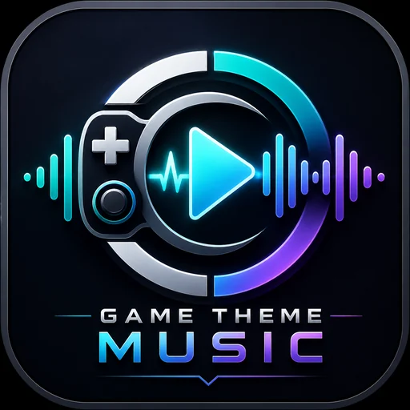
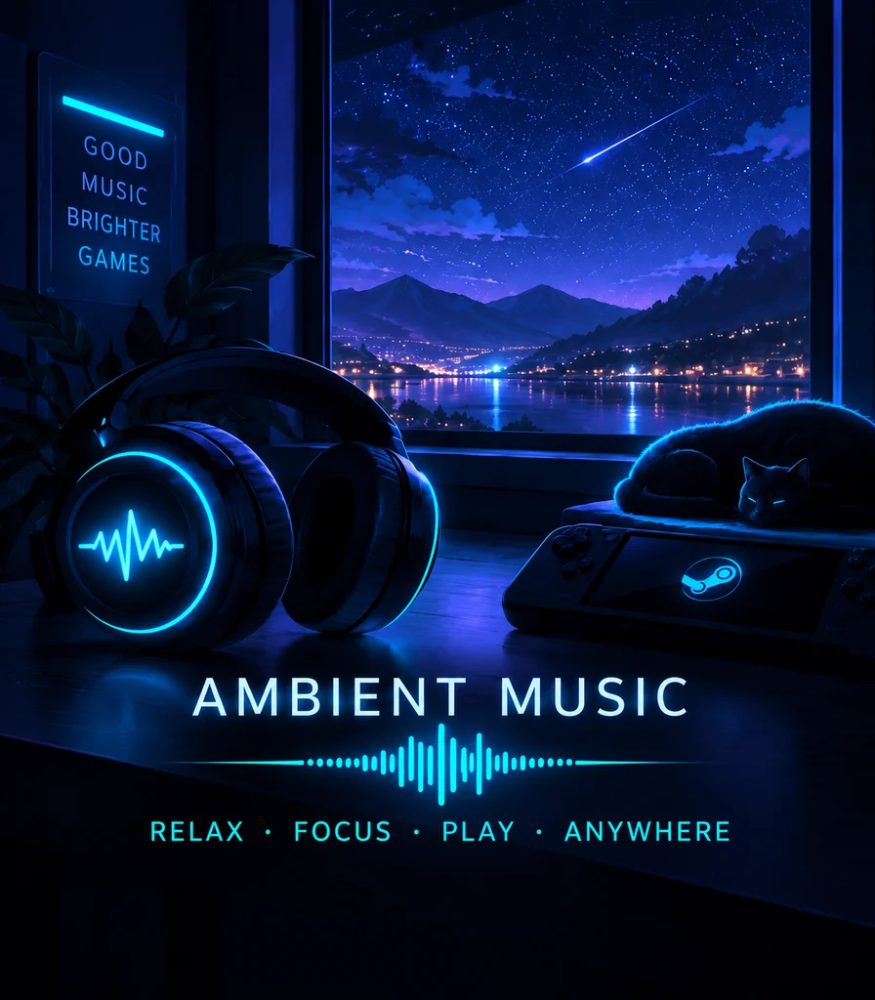
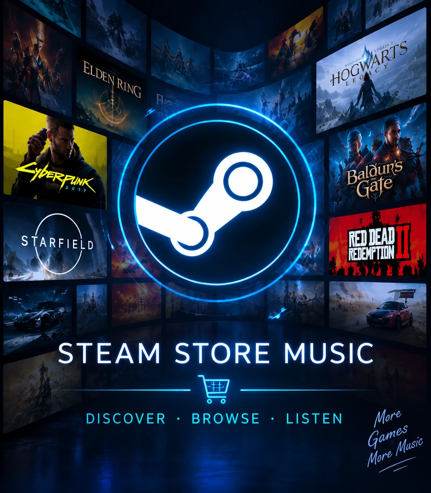

# Game Theme Music screenshots and visual tour

## What's available right now

The repository includes **actual GTM artwork and branding assets** below. These are **not screenshots of the running Steam Deck plugin**. We have not published an authenticated, current **3.7.0 in-game/interface screenshot collection** here yet, and we do not want to mislabel artwork or mockups as real Deck hardware captures.

| GTM identity | Ambient music art | Store music art |
| --- | --- | --- |
|  |  |  |
| Included branding asset | Included Ambient asset | Included Store asset |

## What an authentic Steam Deck gallery should demonstrate

Capture from the **running GTM 3.7.0 plugin**, preferably directly on the Steam Deck:

1. **Quick Access main panel:** version, accessible controls and current playback.
2. **Soundtrack Manager / Games:** one Steam game with visible game artwork and its track list.
3. **Non-Steam game:** an example such as NFS Most Wanted 2005 with its assigned soundtrack.
4. **Ambient and Store:** the separate music sections, with artwork and track controls.
5. **Interface & Feedback:** the **Show mini player HUD** switch in its enabled and disabled states.
6. **Actual Now Playing HUD:** the visible pop-up over a game page so newcomers can see what the switch affects.
7. **Find Music / Import:** controller-first search, previews, or local music management.

Keep images as authentic Steam Deck captures, avoid private account information or personal libraries that should not be public, and ask the copyright holder's permission where necessary. A screenshot of copyrighted game art in a software demonstration is not an endorsement by the game publisher.

## Suggested file layout (for a future, explicitly provided gallery)

```text
docs/screenshots/
  01-quick-access.png
  02-manager-games.png
  03-non-steam-game.png
  04-ambient-and-store.png
  05-hud-toggle.png
  06-now-playing-hud.png
  07-find-and-import.png
```

Do **not** add empty image links to README before the actual files exist. Once the captures are supplied and reviewed, add them to this repository and link each with an accurate caption and alt text. A screenshot section should describe the current release, not an obsolete preview or a visual concept.

## Capturing on Steam Deck

Use Steam's own screenshot method or a screen-capture method you already trust in Gaming Mode. Confirm the capture includes the correct GTM version and depicts the specific feature. Avoid copying screenshots from other plugins or staging a fabricated interface.

[Back to the README](../README.md) · [Getting started](GETTING_STARTED.md)
